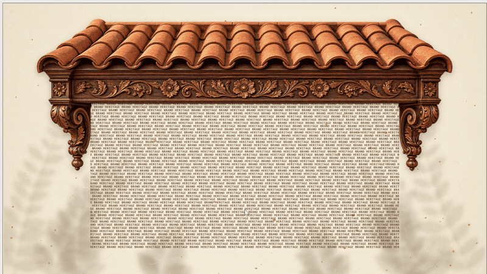

# Interactive Animated Typography Curtain



## Summary

This prompt creates an interactive 16:9 PowerPoint slide in a warm, artisanal heritage style. A two-half curtain woven from repeating text hangs under a terracotta canopy and hides the slide copy. Drag, scroll, touch, or use the keyboard to open the curtain and reveal the title, with soft cloth physics and quiet chimes.

## Prompt

```text
Create one 16:9 interactive slide in a warm, artisanal heritage style.

SCENE
- Background: ivory handmade-paper texture filling the whole slide.
- Top: a photoreal terracotta canopy (fascia/awning) cut out on a transparent background, spanning the slide width.
- Centered copy, hidden behind the curtain at first:
  - Eyebrow: "HERITAGE BRAND" (small, letter-spaced caps)
  - Title: "Zava" (large, elegant serif)
  - Subtitle: "Defining next generation of designs."

CURTAIN
- A two-half letter curtain made of the repeating text "HERITAGE BRAND ", 168 × 46 tiny bold monospace characters in total (84 columns per half). It hangs flush under the canopy and covers the copy.
- The two halves meet at a center seam that is not connected, so each half moves on its own.
- Glyphs get darker where the fabric gathers and lighter where it stretches.
- The curtain settles before it appears, so there is no jolt on load.

PHYSICS (soft, fabric-like, smooth)
- Cloth simulation: soft gravity, firm damping, 3 relaxation passes, top row pinned under the canopy.
- Fixed simulation steps per frame (no variable stepping) for smooth, even motion.
- Extra damping on the outer edges, the center seam and the bottom rows, so the curtain never whips.
- Gathered letters keep at least 25% of their normal spacing, so the curtain can open wide.
- Top-row movement is capped so the fabric never tears or jumps.
- Hem drag: the lower rows follow the top more loosely, increasing toward the bottom edge. When the curtain opens or closes, the hem trails slightly behind and then catches up, like heavy fabric.

INTERACTION
- Drag either half outward to open it (horizontal only, with a gentle, soft pull on the cloth near the cursor).
- The opening is proportional, not all-or-nothing: the seam follows the cursor 1:1. On release, the curtain glides briefly (~0.4 s ease-out) and stays exactly where it was left. It never snaps fully open or closed.
- Scroll opens or closes both halves gradually, in proportion to how far you scroll, with a smooth glide.
- Touch is supported like drag.
- Keyboard: Enter, Space and the arrow keys fully open or close the curtain with a ~1 s ease-in-out.
- Quiet, rate-limited chimes, starting only after the first interaction.
- No hover effect. No focus ring for mouse users (show a visible one for keyboard users only).

RELIABILITY
- Show fallback lettering until the font loads.
- Fully self-contained and works offline (no external fonts, images or scripts).
- No extra UI: no buttons, hints or labels beyond the scene.
- Adapts responsively to any slide size and stays accessible (screen-reader label for the curtain and the hidden copy, reduced-motion support).
```

## Description

This prompt is designed for Copilot in PowerPoint to build a self-contained interactive slide. It combines generated imagery (paper texture and terracotta canopy) with a cloth-simulated typographic curtain that responds to drag, scroll, touch, and keyboard input.

## Use cases

- Brand reveal or launch title slides.
- Interactive openers for keynotes and showcases.
- Showcasing animated typography in presentations.

## Contributors

[Rolly Seth](https://github.com/rollyseth)

## Version history

| Version | Date | Comments |
| ------- | ---- | -------- |
| 1.0 | October 14, 2026 | Initial release |

## Instructions

1. Open PowerPoint.
2. Open Copilot in PowerPoint.
3. Paste the prompt from the Prompt section.
4. Replace the eyebrow, title, subtitle, and curtain text as needed.
5. Run the prompt and review the generated slide.
6. Run the slide in Slide Show mode and try drag, scroll, touch, and keyboard interaction.

## Prerequisites

- Copilot in PowerPoint.

## Help

This sample is provided for community use and learning. If the curtain does not respond, confirm you are in Slide Show mode, then re-run the prompt.

## Disclaimer

**THIS CODE IS PROVIDED _AS IS_ WITHOUT WARRANTY OF ANY KIND, EITHER EXPRESS OR IMPLIED, INCLUDING ANY IMPLIED WARRANTIES OF FITNESS FOR A PARTICULAR PURPOSE, MERCHANTABILITY, OR NON-INFRINGEMENT.**
