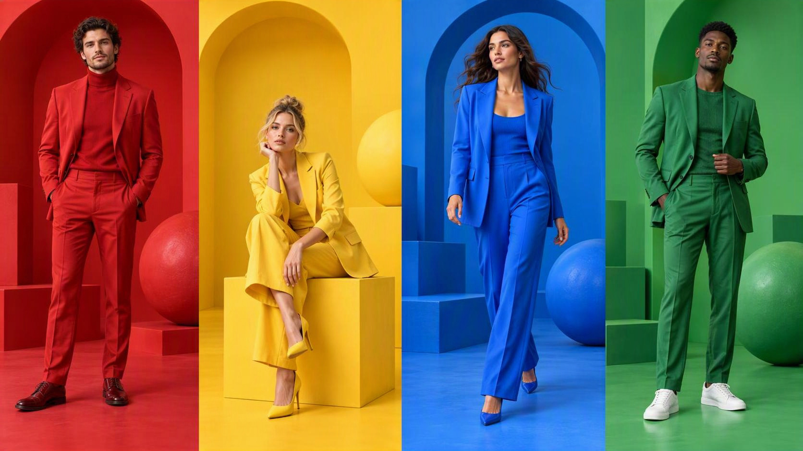
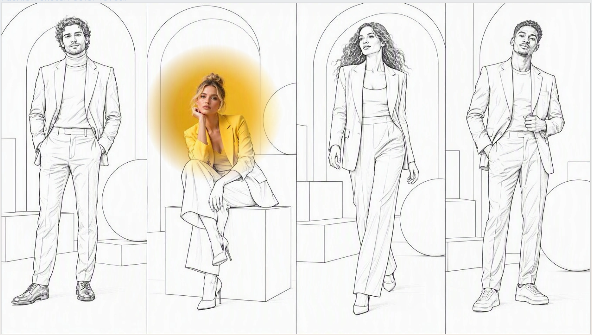
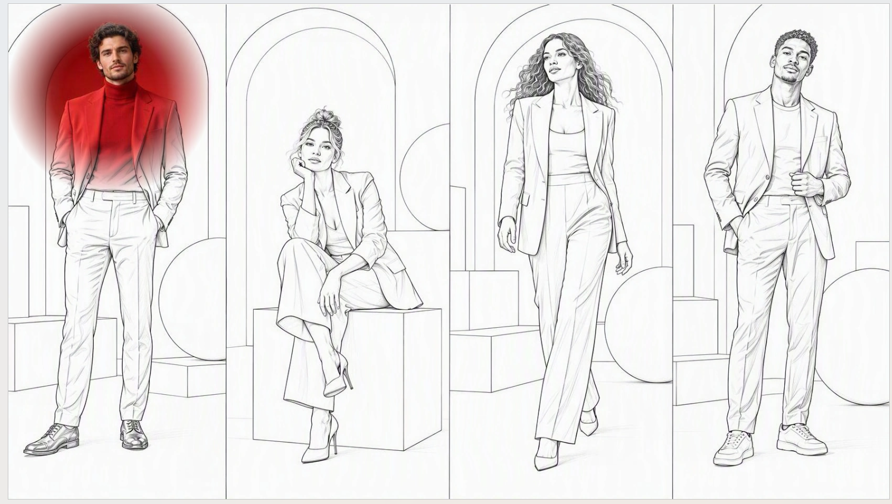

# Interactive Flashlight Reveal

## Summary

This two-prompt workflow creates a vibrant four-panel fashion image, then adds an interactive flashlight reveal on the existing slide. A black-and-white outline layer on white covers the original color image, while a soft circular spotlight follows the pointer to reveal the color underneath.

## Prompt 1: Image generation

Use this prompt to generate the image used in this example.

```text
Create a photorealistic 16:9 fashion image split into four equal vertical panels: red, yellow, blue, and green. Show a man standing in a red suit, a woman seated in a yellow suit, a woman walking in a blue suit, and a man standing in a green suit. Match each background to the outfit, with playful geometric arches, blocks, and spheres. Use vibrant colors, soft studio lighting, and sharp detail. No text or logos.
```

### Output reference



## Prompt 2: Interactive flashlight

Use this prompt on the existing slide containing the original full-resolution image from Prompt 1.

```text
Create an interactive flashlight reveal on the existing slide. Use the original full-resolution image asset, never a screenshot, thumbnail, or preview. Do not downsample, recompress, blur, or replace it. Keep it unchanged beneath a separate black-and-white outline layer on white, matching the reference. Reveal the original color through a 250–350 px circular spotlight with soft feathered edges and a subtle warm glow. Follow the pointer smoothly, fading out on exit and back in on return. Preserve the composition and image detail in both layers. Add no text.
```

### Output references





## Description

The first prompt establishes the full-color source image. The second prompt preserves that original asset beneath a separate outline layer and reveals its color through a pointer-controlled spotlight. The two layers should remain aligned, with the original composition and image detail preserved.

## Use cases

- Interactive fashion and design showcases.
- Audience-controlled color discovery.
- Presentation openers that transition from outline art to photography.

## Contributors

[Rolly Seth](https://github.com/rollyseth)

## Version history

| Version | Date | Comments |
| ------- | ---- | -------- |
| 1.0 | October 16, 2026 | Initial release with two prompts and three output-reference images. |

## Instructions

1. Open Copilot in PowerPoint and use Prompt 1 to generate the fashion image.
2. Place the original full-resolution image on a 16:9 slide. Do not substitute a screenshot, thumbnail, or preview.
3. With that slide open, submit Prompt 2 as an interactive slide creation request, using the output references as visual guidance.
4. Review the generated slide and run it in Slide Show mode.
5. Move the pointer across the scene to reveal the original color. Confirm that the spotlight moves smoothly, fades out when the pointer exits, and fades back in when it returns.
6. Check that the color and outline layers remain aligned and that the original image detail is preserved.

## Prerequisites

- Copilot in PowerPoint with 'create interactive slide' skill available.

## Disclaimer

**THIS CODE IS PROVIDED _AS IS_ WITHOUT WARRANTY OF ANY KIND, EITHER EXPRESS OR IMPLIED, INCLUDING ANY IMPLIED WARRANTIES OF FITNESS FOR A PARTICULAR PURPOSE, MERCHANTABILITY, OR NON-INFRINGEMENT.**
