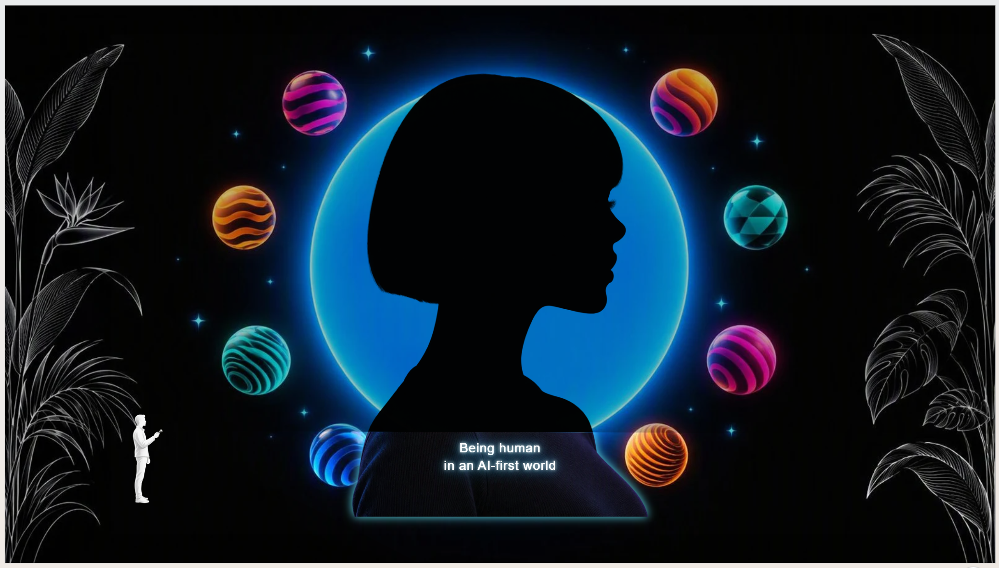
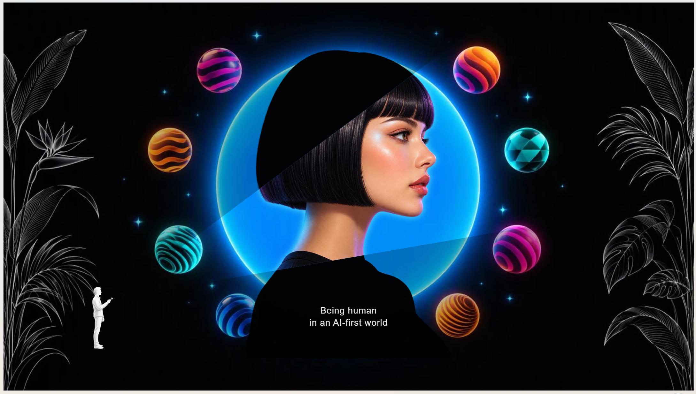

# Interactive Luminous Blob Profile

## Video walkthrough

[](https://youtu.be/mWMga7OZwyM)

## Output references

### Silhouette view



### Torchlight reveal



These images illustrate the intended composition and torchlight reveal. The reference images use the caption "Being human in an AI-first world"; the prompt below retains the requested text "various cover art."

## Summary

This prompt creates a full-slide, 16:9 interactive PowerPoint visual with a minimalist futuristic music-editorial aesthetic. A black side-profile silhouette sits in front of a glowing electric-blue circle, surrounded by colorful patterned spheres. A tiny explorer near the lower-left aims a flashlight whose beam reveals an aligned full-color face and background details.

## Prompt

```text
Create a full-slide, 16:9 landscape interactive slide with Minimalist futuristic music editorial on a pure black background. A large glowing electric-blue circle in center behind a central black silhouette of a blunt hair cut girl in side profile facing right. Surround the halo with small floating colorful spheres featuring abstract patterns, wavy stripes, geometric shapes, and vibrant gradients in coral, magenta, orange, teal, and blue. Add tiny centered white sans-serif text on the silhouette reading “various cover art.” High contrast, bold negative space, crisp graphic shapes, subtle 3D gloss, contemporary album-cover aesthetic, clean composition, 16:9 landscape. Place a tiny minimalist person holding a flashlight in the lower-left, clearly visible among the towering plants. Interactive torchlight Project a long triangular beam from the person’s flashlight, initially aimed diagonally upward to the right. As the pointer moves, rotate the beam toward the cursor while keeping its origin attached to the flashlight. Inside the beam, reveal a perfectly aligned full-color version person’s face (not in dark) and other background elements with a glow/magical effects. Keep movement smooth and responsive for mouse, trackpad, and touch. Allow arrow keys to aim the beam. Keep the explorer near the lower-left with only subtle pointer-responsive movement.
```

## Description

The prompt combines a high-contrast album-cover composition with an interactive torchlight reveal. The beam stays attached to the explorer's flashlight while rotating toward the pointer or responding to arrow keys. Only the illuminated region reveals the full-color face and background details, aligned with the darker scene.

## Use cases

- Interactive opening or section slides.
- Music-editorial and album-cover-inspired presentations.
- Audience-controlled discovery and reveal storytelling.

## Contributors

[Rolly Seth](https://github.com/rollyseth)

## Version history

| Version | Date | Comments |
| ------- | ---- | -------- |
| 1.0 | October 16, 2026 | Initial release with the original prompt and two output-reference images. |

## Instructions

1. Open Copilot in PowerPoint and start an interactive slide creation request.
2. Paste the prompt from the Prompt section.
3. Use the two output-reference images as visual guidance.
4. Review the generated slide and run it in Slide Show mode.
5. Aim the beam with a mouse, trackpad, touch, and arrow keys. Confirm that its origin remains attached to the flashlight and that the revealed face stays aligned with the silhouette.

## Prerequisites

- Copilot in PowerPoint with interactive slide creation available.

## Disclaimer

**THIS CODE IS PROVIDED _AS IS_ WITHOUT WARRANTY OF ANY KIND, EITHER EXPRESS OR IMPLIED, INCLUDING ANY IMPLIED WARRANTIES OF FITNESS FOR A PARTICULAR PURPOSE, MERCHANTABILITY, OR NON-INFRINGEMENT.**
