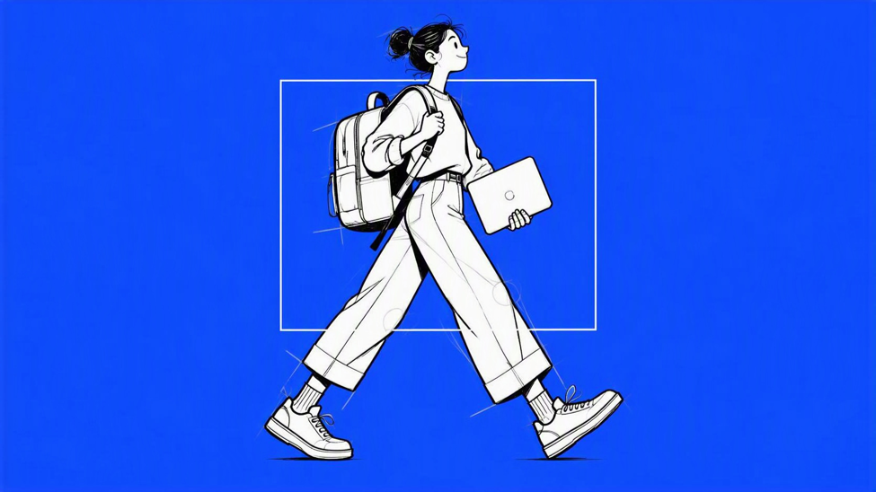
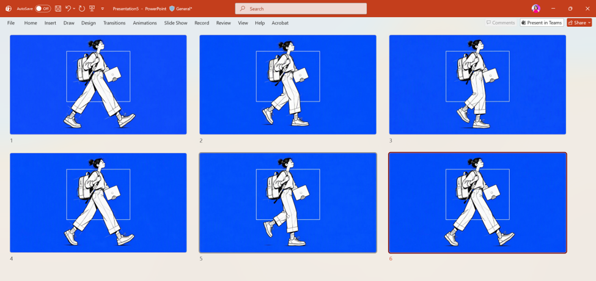
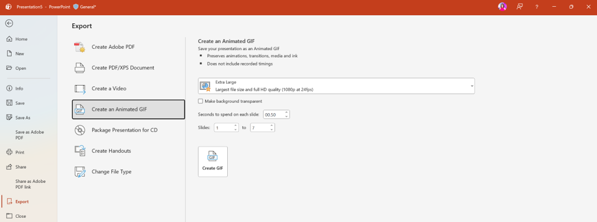
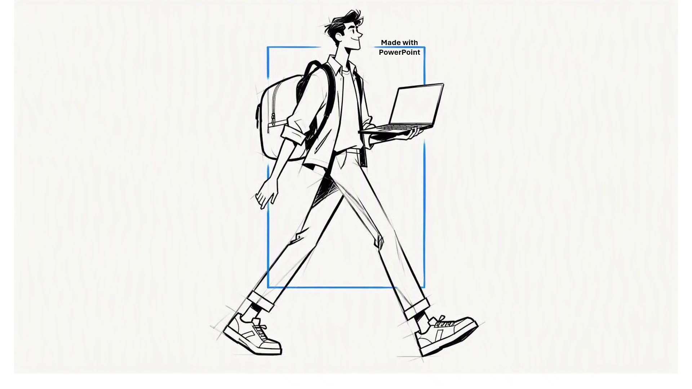

# Walk Cycle Animation with Copilot in PowerPoint

## Video walkthrough

[Watch the walk-cycle animation walkthrough on YouTube](https://youtu.be/TCynPLiXnh0)

## Summary

These prompts create a hand-drawn character illustration, convert it into a consistent six-frame walk cycle across six PowerPoint slides, and export the sequence as a looping animated GIF.

## Prompt 1: Create the source image



```text
Create a minimalist, clean, sharp line hand-drawn black-and-white illustration of a person walking confidently while carrying a laptop and a large laptop backpack on their back. The character should have exaggerated, angular limbs, a dynamic walking pose, and simple, stylized shoes. Add a thin white rectangular outline behind and partially overlapping the figure, creating a subtle geometric accent. Include faint gray construction lines and sketch details for an unfinished, exploratory drawing effect. Plain blue background, high contrast, no shadows, no gradients, no textures, no extra objects, no text. Flat 2D line art, quirky conceptual illustration, contemporary editorial design, lots of negative space, centered composition, minimal color palette of black, white, light gray, and electric blue. Preserve the raw, imperfect hand-sketched quality rather than making the drawing polished or photorealistic.
```

## Prompt 2: Create the walk-cycle slides

Select the image generated with Prompt 1, then use:



```text
Convert the selected image into a six-frame, hand-drawn 2D sequence depicting the exact same character walking continuously from left to right. Each frame must be on its own slide and represent a different consecutive phase of one natural, anatomically coherent walking cycle.

Frame-by-frame motion:
- Frame 1 - Contact pose: One foot extends forward to touch the ground while the opposite leg trails behind. The torso leans slightly forward.
- Frame 2 - Recoil and weight transfer: The body shifts over the planted foot. The trailing leg begins to lift, the knees bend, and the scarf and bag respond to the movement.
- Frame 3 - Passing pose: The trailing leg swings underneath the torso as the body rises slightly. The feet pass close to each other.
- Frame 4 - Opposite contact pose: The opposite foot reaches forward and touches the ground while the first leg moves backward.
- Frame 5 - Opposite passing and push-off: The weight transfers onto the forward foot, the rear heel lifts, and the body begins the next stride.
- Frame 6 - Return stride: The legs extend into the complementary walking pose, transitioning naturally back into Frame 1 to complete the loop.

Character consistency: Maintain exactly the same character design, silhouette, head, limb lengths, hands, shoes, bag, and accessories across all six frames. Only change their positions and rotations as required by the walking motion. Preserve the same scale, camera angle, line thickness, stroke character, background, and overall composition.

Secondary animation: Add subtle vertical body bounce, alternating hip and shoulder movement, natural arm swing, slight bag rotation and bounce, and delayed fabric motion. Keep these movements coordinated with the steps and physically plausible. Avoid exaggerated deformation.
```

## Image references

The sample includes these visual references:

1. A single-character source illustration generated from Prompt 1, with a blue background, white rectangular outline, laptop, and backpack.
2. A six-slide overview showing the same character progressing through the complete walk cycle.
3. The PowerPoint **Create an Animated GIF** export settings.
4. The original high-resolution six-frame animated GIF.

## Instructions

1. Open PowerPoint and create a blank slide.
2. Open Copilot in PowerPoint and submit Prompt 1.
3. Place the generated source illustration on a slide and select it.
4. Submit Prompt 2 to create six slides, with one consecutive walk-cycle frame on each slide.
5. Review the slides in sequence. Confirm that the character design and framing remain consistent and that Frame 6 loops naturally back to Frame 1.
6. In PowerPoint, go to **File > Export > Create an Animated GIF**.
7. Set the duration to **0.5 seconds per slide**, then create the GIF.



## Expected result

A six-frame animated GIF of the character walking continuously from left to right. The loop should preserve the blue background, white rectangular outline, character design, laptop, backpack, drawing style, scale, and camera angle.

- [Download the original 1920x1080 animated GIF](./assets/walk-cycle-1920x1080.gif)

## Another sample output



## Use cases

- Create a lightweight character animation without dedicated animation software.
- Add a looping editorial illustration to a presentation or social post.
- Prototype character motion and visual storytelling directly in PowerPoint.
- Demonstrate image consistency across generated animation frames.

## Contributors

[Rolly Seth](https://github.com/rollyseth)

## Version history

| Version | Date | Comments |
| ------- | ---- | -------- |
| 1.0 | October 11, 2026 | Initial release. |

## Prerequisites

- Copilot in PowerPoint with image generation and selected-image editing available.
- PowerPoint desktop with animated GIF export support.

## Disclaimer

**THIS CODE IS PROVIDED _AS IS_ WITHOUT WARRANTY OF ANY KIND, EITHER EXPRESS OR IMPLIED, INCLUDING ANY IMPLIED WARRANTIES OF FITNESS FOR A PARTICULAR PURPOSE, MERCHANTABILITY, OR NON-INFRINGEMENT.**
